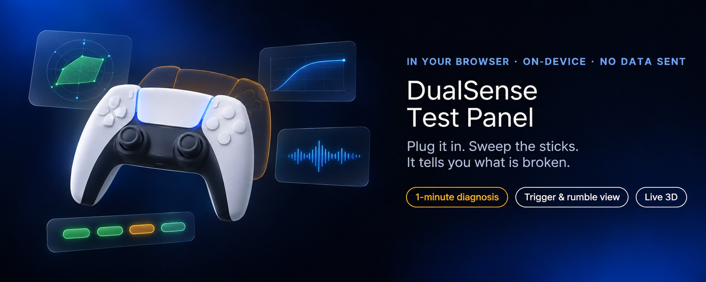
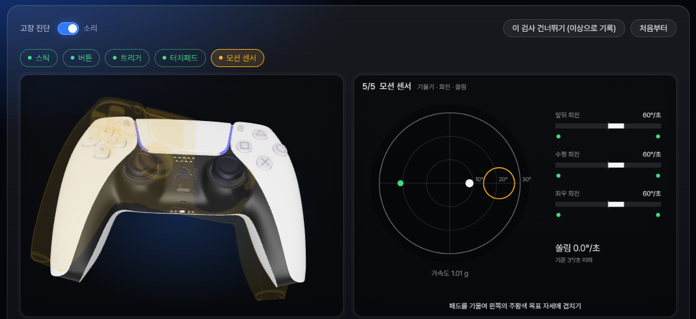
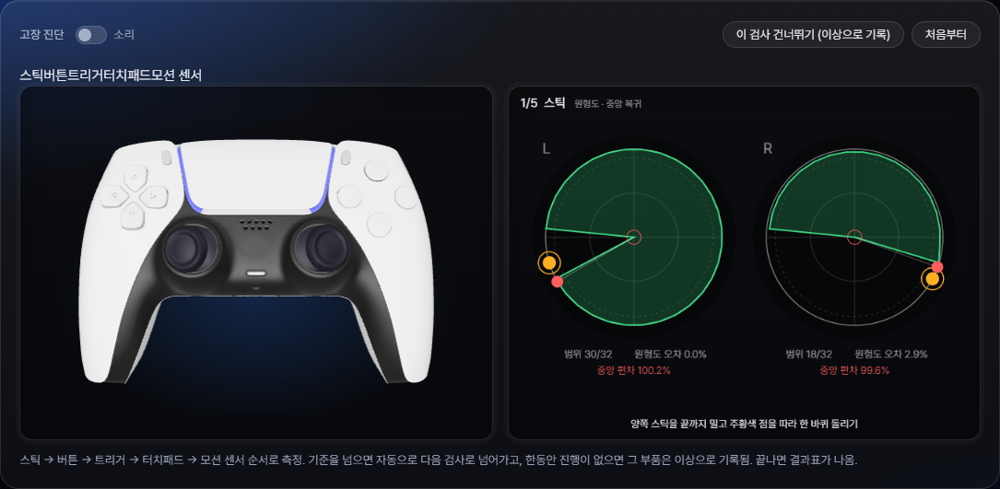

  

  
  

<h1 align="center">Hapticlink</h1>

  
  
  
  

---

브라우저에서 바로 도는 DualSense 테스터.

전부 내 컴퓨터 안에서 끝난다. 페이지는 외부 리소스를 불러오지 않고 아무 데도 보내지 않는다. 패드는 브라우저와만 이야기한다.

중고 패드를 사기 전에, 스틱 쏠림이 의심될 때, 수리를 끝낸 뒤에 쓴다. 패드를 꽂고 화면이 시키는 대로 하면 부품별로 정상인지 이상인지가 나온다.

## 1분 진단

다섯 단계가 차례로 지나간다. 규칙은 하나다. **주황색을 따라가면 통과.**

기준을 넘으면 알아서 다음 단계로 넘어간다. 한동안 진행이 없으면 그 부품을 이상으로 적고 넘어간다. 버튼을 누를 필요가 없다.

| 단계 | 하는 일 | 이상으로 보는 것 |
| --- | --- | --- |
| 스틱 | 주황 점을 따라 한 바퀴 돌리고 손 떼기 | 끝까지 안 닿는 방향, 손을 뗀 뒤 중앙에서 8% 넘게 벗어남 |
| 버튼 | 3D 패드에서 깜빡이는 버튼 19개를 차례로 | 5초 안에 입력이 안 들어옴 |
| 트리거 | 주황 트리거 깊이에 내 트리거 맞추기 | 중간에 못 머묾, 0이나 255가 안 나옴 |
| 터치패드 | 72칸 전부 칠하기 | 끝까지 안 칠해지는 칸 |
| 모션 센서 | 주황 자세에 패드 겹치기, 좌우로 비틀기 | 기울기를 못 읽음, 자이로 축이 무반응, 가만히 있는데 3°/초 넘게 돎 |

스틱은 지나간 범위가 그대로 도형이 된다. 찌그러진 곳이 안 닿는 방향이다.

## 결과는 부품별로

끝나면 카드 다섯 장이 남는다. 정상이면 수치가, 이상이면 무엇이 안 됐는지가 적힌다. "L3 입력 안 됨", "R 스틱 ↗ 방향 끝까지 안 닿음" 같은 식이다. 판매 글이나 A/S 접수에 그대로 붙이면 된다.

## 트리거와 진동을 눈으로

적응형 트리거가 뭔지 말로는 설명이 안 된다. 그래서 그렸다.

트리거 느낌을 고르면 저항이 어디서 걸리는지 곡선으로 나오고, 당기면 점이 곡선 위를 따라간다. 권총은 중간에 턱이 있고, 활시위는 끝으로 갈수록 무거워지고, 기관총은 떨린다. 진동 패턴은 좌우 모터 파형으로 흐른다.

블루투스로 연결하면 패턴이 진동 모터가 아니라 패드의 진동자에서 HD 햅틱으로 나온다. 브라우저에서 바로.

PS5도 지원 게임도 필요 없다.

## 눌린 대로 움직이는 3D

버튼은 빛나고, 스틱은 기울고, 트리거는 당겨진다. 패드를 세우면 모델이 숙여져서 L1·L2·R1·R2가 보인다. 터치패드로 그림도 그려진다.

## 그 밖에

| 탭 | 내용 |
| --- | --- |
| 적응형 트리거 | L2/R2 각각 끔 · 저항 · 방아쇠 · 진동. 슬라이더를 움직이면 바로 적용 |
| 조명 · 진동 | 라이트바 색, 플레이어 LED, 마이크 LED, 좌우 모터 |
| 모션 | 패드 기울기를 그대로 따라가는 3D 모델 |

배터리 잔량과 충전 상태는 항상 위에 떠 있다. 화면은 한국어와 영어로 바뀐다.

## 내려받기

Windows용 프로그램은 [Releases](https://github.com/Johyeonwoooooooo/Hapticlink/releases)에 올라온다. 최신 릴리스에서 `Hapticlink-Setup-<버전>.exe` 를 받아 실행하면 된다.

이 저장소에는 릴리스와 이 문서만 있다. 소스 코드는 공개하지 않는다.

## 자주 묻는 것

**블루투스로도 되나요?**
된다. 패드를 PC에 페어링하고 평소처럼 연결하면 된다. USB 유선과 Pico 2 W 동글([awalol/DS5Dongle](https://github.com/awalol/DS5Dongle))도 된다.

**여기서 맞춘 트리거가 게임에도 남나요?**
안 남는다. 그 탭을 열어둔 동안만 패드에 적용되고, 탭을 옮기면 꺼진다. 게임이 켜져 있으면 게임이 덮어쓴다.

**Firefox에서는요?**
WebHID가 없어서 안 된다.

## 라이선스

Hapticlink는 무료로 쓸 수 있다. 오픈 소스는 아니다: [LICENSE](LICENSE) 참고.

## 출처

- 3D 모델: [PS5 Controller](https://sketchfab.com/3d-models/ps5-controller-b7bb9c5102a04cb0b1966c6d02bad7d6) by Taohid Animation, [CC BY 4.0](https://creativecommons.org/licenses/by/4.0/).
  부품 분리·이름 정리는 [Kollynce/dualsense-controller](https://github.com/Kollynce/dualsense-controller),
  피벗·재질·버튼 기호 보정은 [MoniYeyu/dualsense-reactive-preview](https://github.com/MoniYeyu/dualsense-reactive-preview) 의 수정본을 그대로 사용.
- [three.js](https://github.com/mrdoob/three.js): MIT.
- 글꼴: [Pretendard](https://github.com/orioncactus/pretendard), SIL Open Font License 1.1.

비공식 프로젝트. Sony Interactive Entertainment와 무관하며, PlayStation·DualSense 및 관련 로고는 각 권리자의 상표.
