

  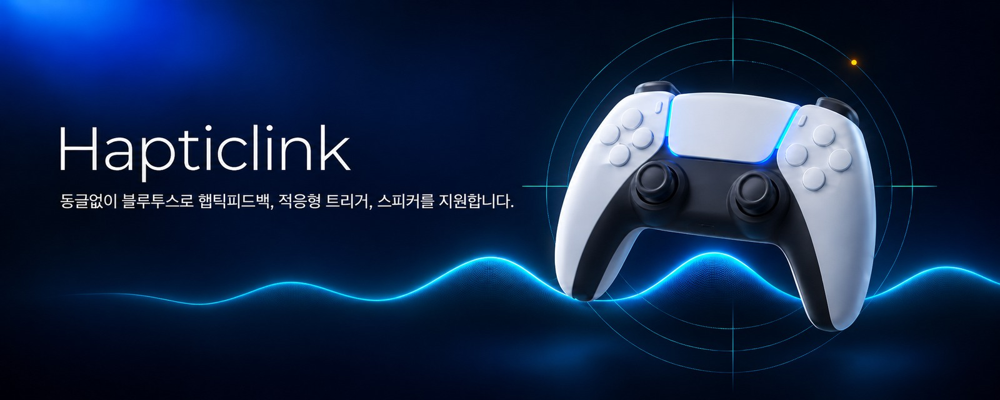

  

  Windows 10/11 64비트 · 161 MB · 아직 코드 서명 없음: "Windows의 PC 보호" 창에서 <i>추가 정보</i> → <i>실행</i> · <a href="https://github.com/Johyeonwoooooooo/Hapticlink/releases">모든 릴리스</a>

  버그를 발견하셨거나 궁금한 점이 있으면 이슈나 이메일로 알려 주세요.

  &nbsp;&nbsp;&nbsp;&nbsp;
  

  
  

<h1 align="center">Hapticlink</h1>

  
  
  

---

Hapticlink는 DualSense 컨트롤러를 위한 Windows 프로그램입니다. 두 가지 일을 합니다.

**무선 패드를 게임에서 유선처럼 쓸 수 있게 해 줍니다.** 패드를 블루투스로 연결하고 Hapticlink를 켠 뒤 게임을 시작하면 됩니다. 햅틱 피드백, 적응형 트리거, 패드 스피커가 케이블도 동글도 없이 동작합니다.

**패드가 멀쩡한지 알려 드립니다.** 스틱 쏠림이 의심될 때, 수리를 받은 뒤에 써 보세요. 화면의 안내를 따라 하면 부품별로 정상인지 이상인지 알 수 있습니다.

모든 일은 내 PC 안에서 끝납니다. Hapticlink는 사용자와 컴퓨터에 관한 어떤 정보도 밖으로 보내지 않습니다. 외부에 연결하는 것은 직접 업데이트를 누를 때뿐입니다.

## 유튜브로 보기

<table>
  <tr>
    <td width="50%"><a href="https://youtu.be/buaXRxuwuzE">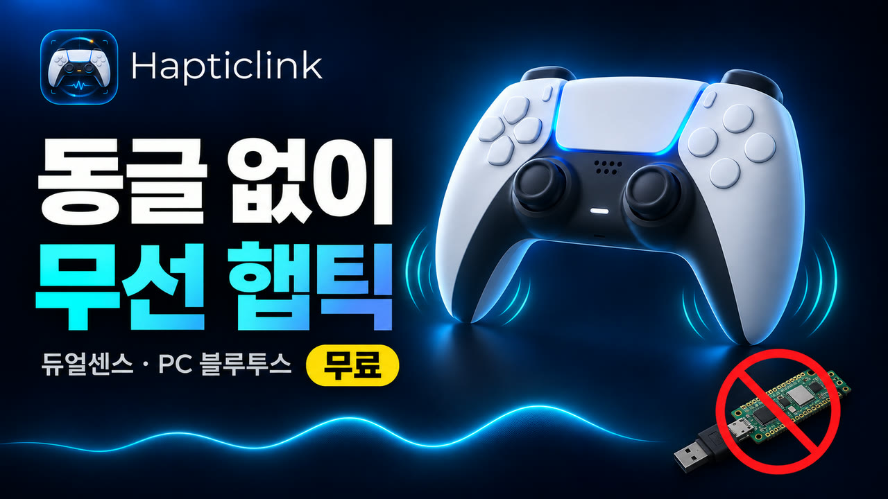</a></td>
    <td width="50%"><a href="https://youtu.be/ffSqCBLcKko">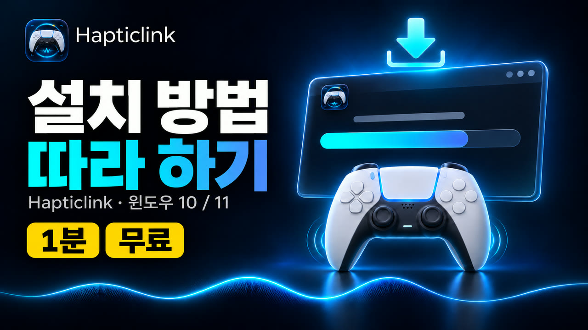</a></td>
  </tr>
  <tr>
    <td valign="top"><b><a href="https://youtu.be/buaXRxuwuzE">Hapticlink가 하는 일</a></b> (1:35) 블루투스만 연결했을 때와 Hapticlink를 켰을 때의 패드 소리를 들려 드리고, 속도와 안정성, 패드 점검을 보여 드립니다.</td>
    <td valign="top"><b><a href="https://youtu.be/ffSqCBLcKko">설치 방법</a></b> (1:29) 내려받기부터 첫 연결까지, Windows 경고 창을 넘기는 방법도 함께 담았습니다.</td>
  </tr>
</table>

영상에는 한국어 음성과 한국어 자막이 들어 있습니다. 음성은 재생 화면의 설정에서 바꿀 수 있습니다.

## 유선보다 평균 2 ms 앞선 입력

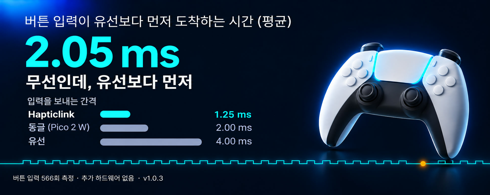

패드 하나를 케이블과 Hapticlink에 동시에 연결한 뒤, 같은 버튼 입력이 각각 PC에 도착한 시각을 비교했습니다. 동글도 같은 방법으로 쟀습니다.

| | 필요한 것 | 선 | 준비 | 입력 간격 | 유선과의 차이 (평균) | 유선보다 먼저 온 입력 |
| --- | --- | --- | --- | --- | --- | --- |
| **Hapticlink** | **없음** | **없음** | **설치 파일 실행** | **1.25 ms** | **2.05 ms 먼저** | **94%** |
| 유선 | USB 케이블 | 있음 | 케이블 꽂기 | 4.00 ms | 기준 | - |
| 추가 하드웨어 (Pico 2 W 동글) | Pico 2 W 보드 | 없음 | 보드 구매, 펌웨어 설치 | 2.00 ms | 0.28 ms 늦음 | 27% |

유선 DualSense는 4 ms마다, 블루투스는 1.25 ms마다 입력을 보냅니다. Hapticlink는 블루투스로 받은 입력을 받는 즉시 게임에 넘깁니다. 그래서 전파와 Hapticlink를 거치고도 대부분 무선 쪽이 먼저 도착합니다.

- **유선과의 차이**는 버튼을 누른 순간부터 잰 시간이 아니라, 같은 입력이 유선보다 얼마나 먼저 또는 늦게 도착했는지입니다. 패드 안에서 걸리는 시간은 양쪽이 같습니다. 중앙값으로는 2.46 ms 먼저였습니다.
- **입력 간격**은 입력을 한 번 보내고 다음 입력을 보낼 때까지의 시간(중앙값)입니다. 짧을수록 자주 보냅니다.
- Hapticlink는 버튼 입력 566회, 동글은 275회를 쟀습니다.

## 안정성은 블루투스 그대로

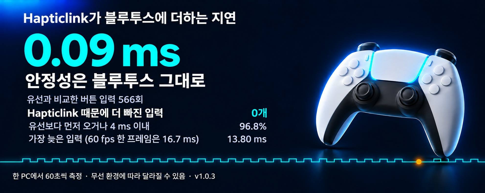

Hapticlink를 거쳐도 입력이 더 늦어지거나 더 빠지지 않습니다. 같은 패드를 블루투스로 직접 읽은 것과 나란히 비교했습니다.

| | 결과 |
| --- | --- |
| Hapticlink가 더하는 지연 | 0.09 ms (중앙값), 95%는 0.17 ms 이내 |
| Hapticlink 때문에 더 빠진 입력 | 0개 |
| 유선보다 먼저 오거나 4 ms 이내로 온 입력 | 96.8% |
| 유선보다 가장 늦게 온 입력 | 13.80 ms |

60 fps 게임의 한 프레임은 16.7 ms입니다. 버튼 입력 566회 가운데 가장 늦은 것도 한 프레임 안에 도착했습니다.

다만 무선은 유선처럼 끊김이 0은 아닙니다. 블루투스 자체가 가끔 입력을 놓치고, 그 순간에는 유선보다 늦습니다. 입력 100번 중 5번은 유선보다 1.53 ms 이상 늦었습니다.

모든 수치는 PC 한 대에서 Hapticlink(v1.0.3)와 동글을 각각 60초 동안 한 번씩 측정한 값이며, 블루투스 어댑터와 주변 무선 환경에 따라 달라질 수 있습니다.

## 케이블 없이, 유선 그대로

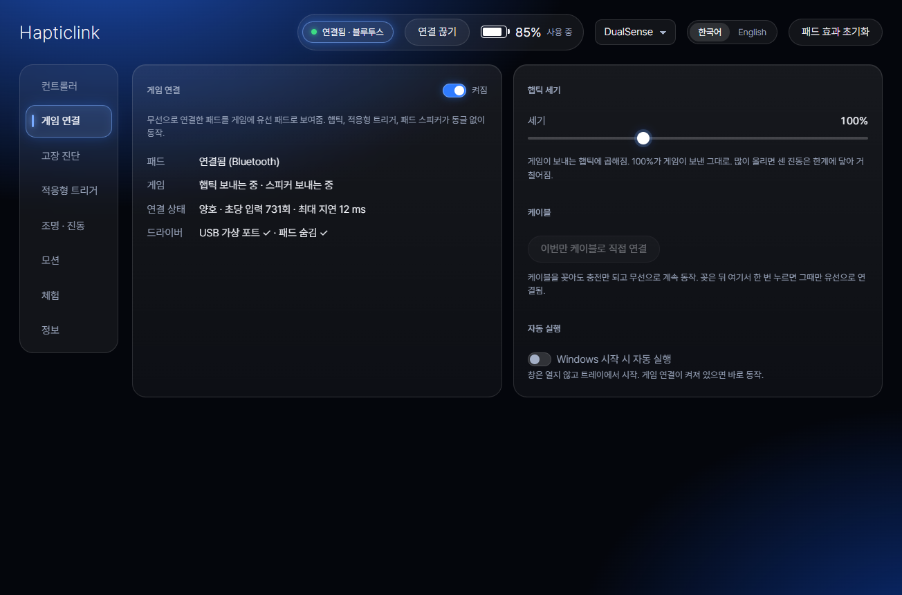

블루투스로 연결한 DualSense는 Windows 게임에 평범한 게임패드로만 보입니다. 햅틱도, 트리거 효과도, 스피커도 쓸 수 없습니다. 게임이 이런 기능을 케이블로 연결된 패드에만 보내기 때문입니다.

Hapticlink는 게임에 유선 DualSense를 보여 주고, 게임이 보내는 것을 모두 블루투스로 실제 패드에 전달합니다. 게임에서 따로 설정하실 것은 없습니다.

- **햅틱 세기**: 0~300% 범위에서 조절할 수 있고, 게임 중에도 바로 적용됩니다.
- **케이블은 충전만**: 게임 도중에 케이블을 꽂아도 아무것도 바뀌지 않습니다. 유선 품질로 쓰고 싶을 때는 버튼 하나로 전환할 수 있고, 케이블을 뽑으면 다시 무선으로 돌아옵니다.
- **방해하지 않습니다**: 트레이에 조용히 머물고, Windows를 시작할 때 함께 켜지도록 할 수 있으며, 종료하면 모든 것을 원래대로 돌려놓습니다.

## 게임 위에 뜨는 오버레이

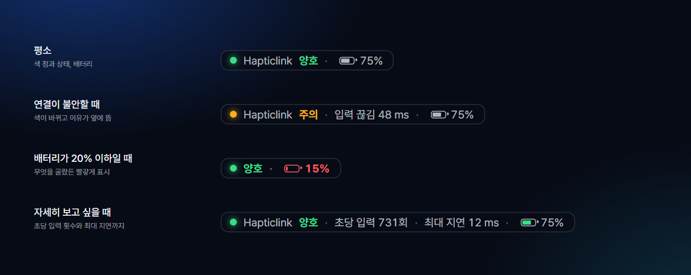

무선은 가끔 끊깁니다. 오버레이는 패드의 블루투스 상태를 게임 화면 위에 작게 띄워 줍니다. 입력이 이상하게 느껴질 때 패드 문제인지 바로 알 수 있습니다.

- **색으로 한눈에**: 초록은 양호, 주황은 주의, 빨강은 나쁨입니다. 주의나 나쁨일 때는 이유가 옆에 같이 뜹니다.
- **배터리**: 잔량을 보여 주고, 20% 이하가 되면 빨갛게 알려 줍니다.
- **필요할 때만**: "문제 있을 때만"으로 설정하면 평소에는 숨어 있다가, 연결이 불안하거나 배터리가 부족할 때만 뜹니다. 다른 오버레이와 같이 써도 화면이 지저분해지지 않습니다.
- **게임 중에 ON/OFF**: 키보드 단축키(기본 Ctrl+Alt+H)나 패드 버튼(기본 L1 + R1 + L2 + R2 + 터치패드 클릭)으로 켜고 끕니다. 둘 다 바꿀 수 있습니다.
- **드래그로 위치 이동**: 오른쪽 끝의 핸들을 잡고 드래그하면 옮겨지고, 화면 끝에 가까이 가면 붙습니다.

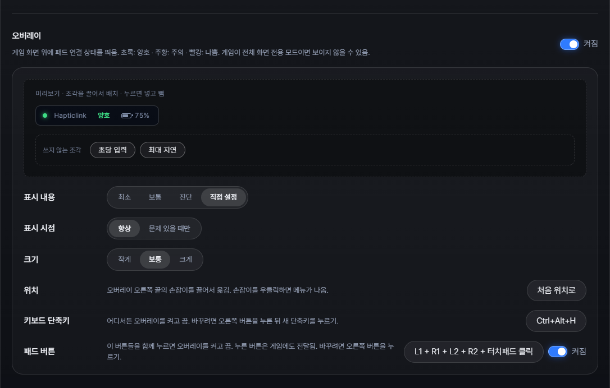

표시할 내용은 최소, 보통, 진단 프리셋 중에서 고르거나 직접 커스텀할 수 있습니다. 직접 설정에서는 항목을 미리보기로 드래그해서 넣고, 드래그로 순서를 바꾸고, 밖으로 드래그해서 뺍니다. 미리보기에 보이는 그대로 오버레이가 됩니다.

오버레이는 기본으로 꺼져 있고, 정보 탭에서 켭니다. 게임이 전체 화면 전용 모드(Exclusive Fullscreen)면 안 보일 수 있습니다. 그럴 때는 게임을 보더리스(테두리 없는 창) 모드로 바꿔 보세요.

## 패드 연결 끊기, 전원 끄기, 패드 고르기

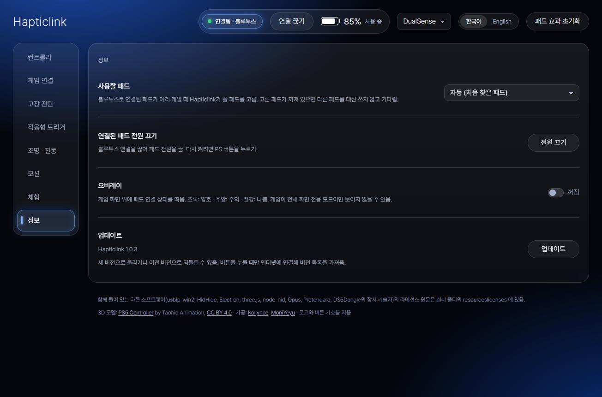

- **연결 끊기**: 화면 맨 위의 *연결 끊기*를 누르면 Hapticlink가 패드를 놓습니다. 패드는 꺼지지 않고 평범한 블루투스 패드로 남습니다. *컨트롤러 연결*을 누르면 다시 잡습니다.
- **전원 끄기**: 정보 탭에서 연결된 패드의 전원을 바로 끌 수 있습니다. 게임이 끝난 뒤 PS 버튼을 길게 누르고 있을 필요가 없습니다. 다시 켤 때는 PS 버튼을 누르시면 됩니다.
- **패드 고르기**: 블루투스로 연결된 패드가 여러 대일 때 Hapticlink가 쓸 패드를 정할 수 있습니다. 고른 패드가 꺼져 있으면 다른 패드를 대신 잡지 않고 기다립니다.

## 1분 진단

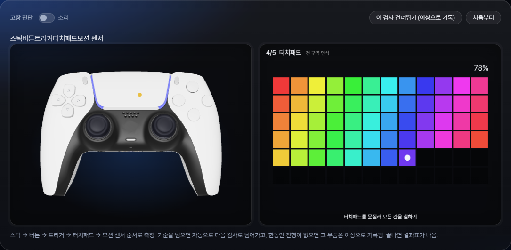

다섯 단계가 차례로 진행됩니다. 규칙은 하나뿐입니다. **주황색을 따라가면 통과합니다.**

기준을 넘으면 자동으로 다음 단계로 넘어갑니다. 한동안 진행이 없으면 그 부품을 이상으로 기록하고 넘어갑니다. 버튼을 따로 누르실 필요가 없습니다.

| 단계 | 하는 일 | 이상으로 보는 것 |
| --- | --- | --- |
| 스틱 | 주황 점을 따라 한 바퀴 돌리고 손 떼기 | 끝까지 닿지 않는 방향, 손을 뗀 뒤 중앙에서 8% 넘게 벗어남 |
| 버튼 | 3D 패드에서 깜빡이는 버튼 19개를 차례로 누르기 | 5초 안에 입력이 들어오지 않음 |
| 트리거 | 주황 트리거 깊이에 내 트리거 맞추기 | 중간에 머물지 못함, 0이나 255가 나오지 않음 |
| 터치패드 | 72칸 전부 칠하기 | 끝까지 칠해지지 않는 칸 |
| 모션 센서 | 주황 자세에 패드 겹치기, 좌우로 비틀기 | 기울기를 읽지 못함, 자이로 축이 반응하지 않음, 가만히 있는데 초당 3° 넘게 회전 |

스틱이 지나간 범위는 그대로 도형이 됩니다. 찌그러진 곳이 스틱이 닿지 않는 방향입니다.

## 부품별 진단 결과

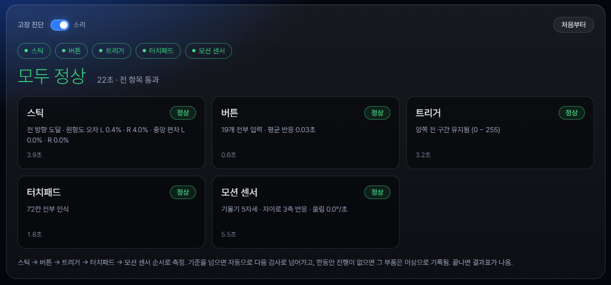

진단이 끝나면 카드 다섯 장이 남습니다. 정상이면 수치가, 이상이면 무엇이 안 됐는지가 적힙니다. "L3 입력 안 됨", "R 스틱 ↗ 방향 끝까지 안 닿음" 같은 식입니다. 판매 글이나 A/S 접수에 그대로 붙여 쓰셔도 좋습니다.

## 눈으로 보는 트리거와 진동

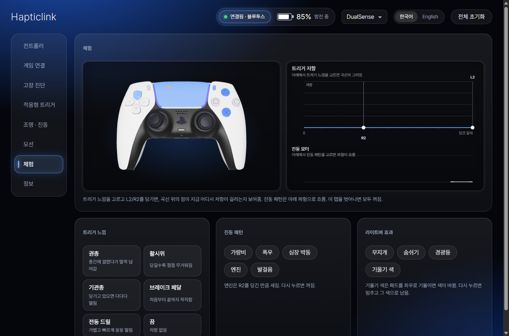

적응형 트리거가 어떤 느낌인지는 말로 설명하기 어렵습니다. 그래서 그림으로 보여 드립니다.

트리거 느낌을 고르면 저항이 어디서 걸리는지 곡선으로 나타나고, 트리거를 당기면 점이 곡선 위를 따라갑니다. 권총은 중간에 턱이 있고, 활시위는 끝으로 갈수록 무거워지며, 기관총은 떨립니다. 진동 패턴은 좌우 모터의 파형으로 흘러갑니다.

블루투스로 연결하면 패턴이 진동 모터가 아니라 패드의 진동자에서 HD 햅틱으로 재생됩니다.

PS5도, 지원 게임도 필요하지 않습니다.

## 누른 대로 움직이는 3D 패드

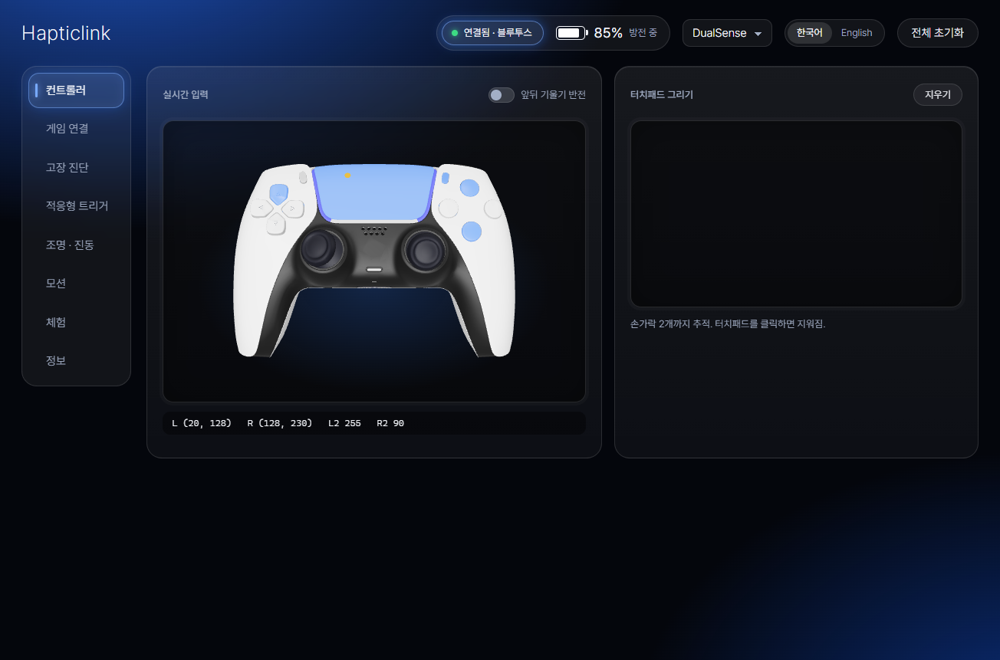

버튼을 누르면 빛나고, 스틱은 기울며, 트리거는 당겨집니다. 패드를 세우면 모델이 숙여져 L1·L2·R1·R2가 보입니다. 터치패드로 그림도 그릴 수 있습니다.

## 그 밖의 기능

| 탭 | 내용 |
| --- | --- |
| 적응형 트리거 | L2/R2 각각 끔 · 저항 · 방아쇠 · 진동을 고를 수 있고, 슬라이더를 움직이면 바로 적용됩니다 |
| 조명 · 진동 | 라이트바 색, 플레이어 LED, 마이크 LED, 좌우 모터 |
| 모션 | 패드의 기울기를 그대로 따라가는 3D 모델 |

배터리 잔량과 충전 상태는 항상 화면 위쪽에 표시됩니다. 화면 언어는 한국어와 영어 중에서 고를 수 있습니다.

## 설치

맨 위 버튼이나 [Releases](https://github.com/Johyeonwoooooooo/Hapticlink/releases)에서 설치 파일을 받아 실행해 주세요.

- Hapticlink와 함께, 게임 연결에 필요한 드라이버 두 개가 설치됩니다: [usbip-win2](https://github.com/vadimgrn/usbip-win2) 0.9.8.1, [HidHide](https://github.com/nefarius/HidHide) 1.5.230. 각 제작자가 서명한 설치 파일을 그대로 사용하며, 설치 중에 따로 내려받는 것은 없습니다.
- Windows를 다시 시작해야 할 수 있습니다.
- 처음 실행하면 사용할 언어와 Windows를 시작할 때 함께 켤지를 묻습니다. 둘 다 나중에 바꿀 수 있습니다.
- 아직 코드 서명이 되어 있지 않습니다. "Windows의 PC 보호" 창이 뜨면 *추가 정보* → *실행*을 눌러 주세요.
- 새 버전은 정보 탭의 *업데이트*에서 받을 수 있습니다. 인터넷 연결이 필요하며, 설정은 그대로 남습니다. 더 낮은 버전으로 되돌릴 수도 있습니다.
- 프로그램을 제거하면 이 설치 파일이 넣은 드라이버도 함께 지워집니다. 원래 PC에 있던 드라이버는 건드리지 않습니다.

## 자주 묻는 질문

**어떤 게임에서 되나요?**
PC에서 유선 DualSense의 햅틱과 적응형 트리거를 지원하는 게임에서 됩니다. 게임이 Steam Input을 사용한다면 켠 상태와 끈 상태를 모두 시도해 보세요. 게임마다 맞는 설정이 다릅니다.

**무선도 유선만큼 센가요?**
조금 약합니다. 블루투스는 케이블보다 담을 수 있는 정보가 적어서 같은 효과가 살짝 부드럽게 느껴집니다. 햅틱 세기 슬라이더로 대부분 보완할 수 있습니다.

**케이블을 꽂았는데 아무것도 안 바뀌어요.**
의도된 동작입니다. 케이블은 충전만 하고 게임은 무선으로 계속됩니다. 케이블로 직접 연결해 쓰고 싶으시면 게임 연결 탭에서 "이번만 케이블로 직접 연결"을 누른 뒤 게임을 다시 시작해 주세요.

**케이블을 뽑으니 패드가 꺼졌어요.**
케이블로 직접 연결해 쓴 뒤에는 그럴 수 있습니다. PS 버튼을 누르면 무선으로 다시 연결됩니다.

**패널에서 맞춘 트리거가 게임에도 남나요?**
남지 않습니다. 해당 탭을 열어 둔 동안에만 적용되며, 게임이 실행 중이면 게임의 설정이 우선합니다.

**서버로 무언가 보내나요?**
보내지 않습니다. 계정도, 사용 기록 수집도, 자동 업데이트 확인도 없습니다. 외부에 연결하는 것은 정보 탭에서 직접 업데이트를 누를 때뿐이며, 그때 GitHub에서 버전 목록과 설치 파일을 받습니다. 화면을 그리는 부분은 호스트 이름을 조회하는 것조차 할 수 없도록 만들어져 있습니다.

## 문의

  &nbsp;&nbsp;&nbsp;&nbsp;
  

동작하지 않는 부분이 있거나 게임이 기대와 다르게 반응한다면 [이슈](https://github.com/Johyeonwoooooooo/Hapticlink/issues)로 알려 주세요. 아래 내용을 함께 적어 주시면 큰 도움이 됩니다.

- Hapticlink 버전(정보 탭에 표시됩니다)과 Windows 버전
- 패드 연결 방식(블루투스 또는 케이블)
- 게임 이름, 그리고 그 게임에서 Steam Input을 켰는지 껐는지
- 무엇을 하셨는지, 어떻게 되기를 기대하셨는지, 실제로는 어떻게 되었는지

새 이슈를 남기기 전에 [기존 이슈](https://github.com/Johyeonwoooooooo/Hapticlink/issues)에 같은 내용이 있는지 한 번 살펴봐 주세요. 공개적으로 적기 어려운 내용은 이메일로 보내 주셔도 좋습니다.

## 라이선스

Hapticlink는 무료로 사용하실 수 있습니다. 다만 오픈 소스는 아닙니다. 자세한 내용은 [LICENSE](LICENSE)를 참고해 주세요.

## 출처

- 3D 모델: [PS5 Controller](https://sketchfab.com/3d-models/ps5-controller-b7bb9c5102a04cb0b1966c6d02bad7d6) by Taohid Animation, [CC BY 4.0](https://creativecommons.org/licenses/by/4.0/).
  부품 분리와 이름 정리는 [Kollynce/dualsense-controller](https://github.com/Kollynce/dualsense-controller),
  피벗·재질·버튼 기호 보정은 [MoniYeyu/dualsense-reactive-preview](https://github.com/MoniYeyu/dualsense-reactive-preview)의 수정본에서 PlayStation 로고와 버튼 기호(△○×□)를 지워서 사용했습니다.
- [three.js](https://github.com/mrdoob/three.js): MIT.
- 글꼴: [Pretendard](https://github.com/orioncactus/pretendard), SIL Open Font License 1.1.

비공식 프로젝트입니다. Sony Interactive Entertainment와 관련이 없으며, PlayStation, DualSense, PS5는 Sony Interactive Entertainment Inc.의 상표 또는 등록 상표입니다.
