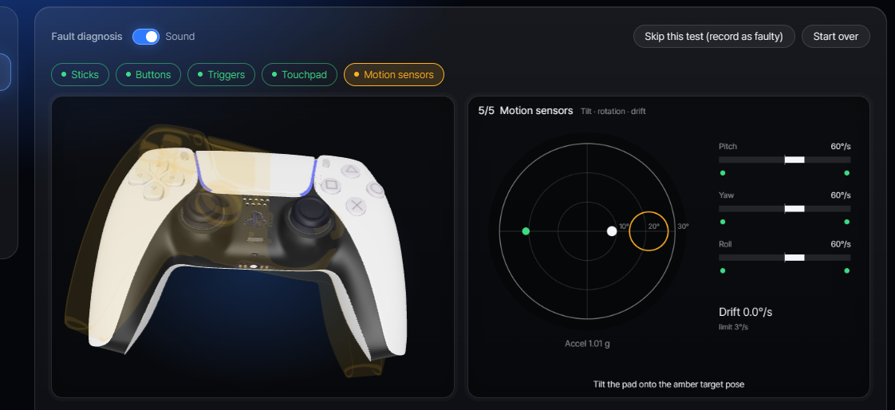
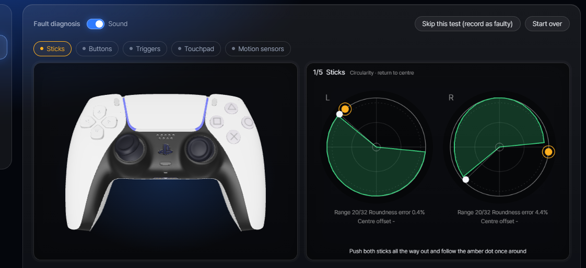
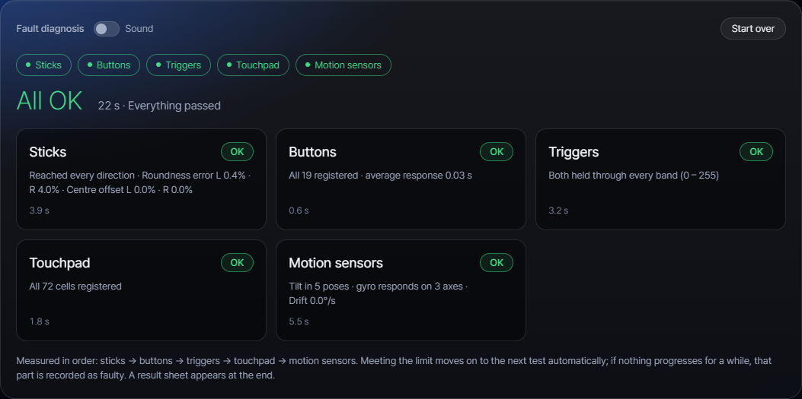

  

  
  

<h1 align="center">Hapticlink</h1>

  
  
  
  

---

A DualSense tester that runs in the browser.

Everything happens on your machine. The page loads no outside resources and sends nothing anywhere: the pad talks to the browser, and that is where it stops.

Use it before buying a used pad, when you suspect stick drift, or after a repair. Plug the pad in, do what the screen asks, and it tells you part by part whether each one is fine or faulty.

## A one-minute diagnosis

Five stages, one after another. There is one rule: **follow the amber and you pass.**

Meeting the limit moves on to the next stage by itself. If nothing progresses for a while, that part is recorded as faulty and the run moves on. There is nothing to click.

| Stage | What you do | What counts as a fault |
| --- | --- | --- |
| Sticks | Follow the amber dot once around, then let go | A direction that never reaches the rim; resting more than 8% off centre |
| Buttons | Press each of the 19 buttons as it flashes on the 3D pad | No input within 5 seconds |
| Triggers | Match your trigger to the amber one | Cannot hold a middle band; never reads 0 or 255 |
| Touchpad | Paint all 72 cells | A cell that never fills |
| Motion sensors | Line the pad up with the amber pose, then twist it | Tilt not read; a gyro axis that never responds; turning more than 3°/s while still |

The sticks draw their own range. Where the shape is dented, the stick does not reach.

## Results, part by part

You end with five cards. A healthy part shows its numbers; a faulty one says what failed, such as "No input: L3" or "R stick does not reach ↗". Paste it straight into a listing or a repair request.

## Triggers and rumble, made visible

Adaptive triggers are hard to describe. So this draws them.

Pick a trigger feel and the curve shows where the resistance sets in; pull the trigger and a dot rides along it. The pistol has a step halfway, the bowstring gets heavier toward the end, the machine gun rattles. Rumble patterns scroll past as a waveform for each motor.

Paired over Bluetooth, the patterns play as HD haptics on the pad's actuators instead of the rumble motors, straight from the browser.

No PS5 and no supported game needed.

## A 3D pad that moves as you press

Buttons light up, sticks tilt, triggers pull. Stand the pad up and the model tips over to show L1, L2, R1 and R2. The touchpad draws.

## Everything else

| Tab | What it does |
| --- | --- |
| Adaptive triggers | Off, resistance, trigger pull or vibration for L2 and R2 separately. Sliders apply as you move them |
| Lighting · Rumble | Light bar colour, player LEDs, microphone LED, both motors |
| Motion | A 3D model that follows the pad's tilt |

Battery level and charging state stay in the header. The interface switches between Korean and English.

## Download

The Windows program is published under [Releases](https://github.com/Johyeonwoooooooo/Hapticlink/releases). Download `Hapticlink-Setup-<version>.exe` from the latest release and run it.

This repository holds the releases and this page. The source code is not public.

## FAQ

**Does it work over Bluetooth?**
Yes. Pair the pad with the PC and connect as usual. A USB cable and a Pico 2 W dongle ([awalol/DS5Dongle](https://github.com/awalol/DS5Dongle)) work too.

**Do trigger settings made here carry over to games?**
No. They apply only while that tab is open and switch off when you leave it. A running game overrides them anyway.

**Firefox?**
It has no WebHID, so no.

## Licence

Hapticlink is free to use. It is not open source: see [LICENSE](LICENSE).

## Credits

- 3D model: [PS5 Controller](https://sketchfab.com/3d-models/ps5-controller-b7bb9c5102a04cb0b1966c6d02bad7d6) by Taohid Animation, [CC BY 4.0](https://creativecommons.org/licenses/by/4.0/).
  Parts separated and named by [Kollynce/dualsense-controller](https://github.com/Kollynce/dualsense-controller);
  pivots, materials and button glyphs corrected by [MoniYeyu/dualsense-reactive-preview](https://github.com/MoniYeyu/dualsense-reactive-preview), whose version is used as is.
- [three.js](https://github.com/mrdoob/three.js): MIT.
- Font: [Pretendard](https://github.com/orioncactus/pretendard), SIL Open Font License 1.1.

An unofficial project, not affiliated with Sony Interactive Entertainment. PlayStation, DualSense and related logos are trademarks of their respective owners.
