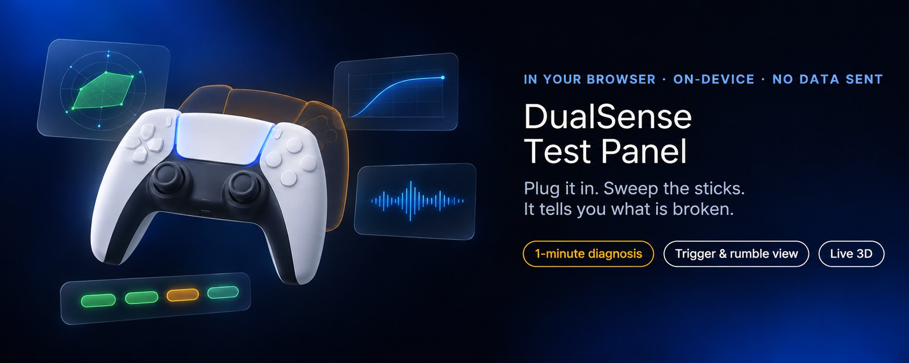
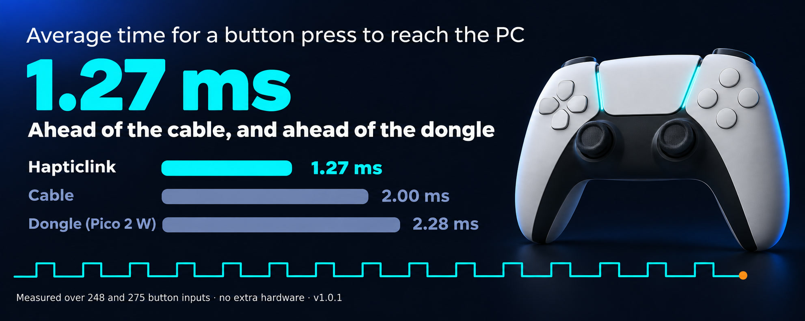
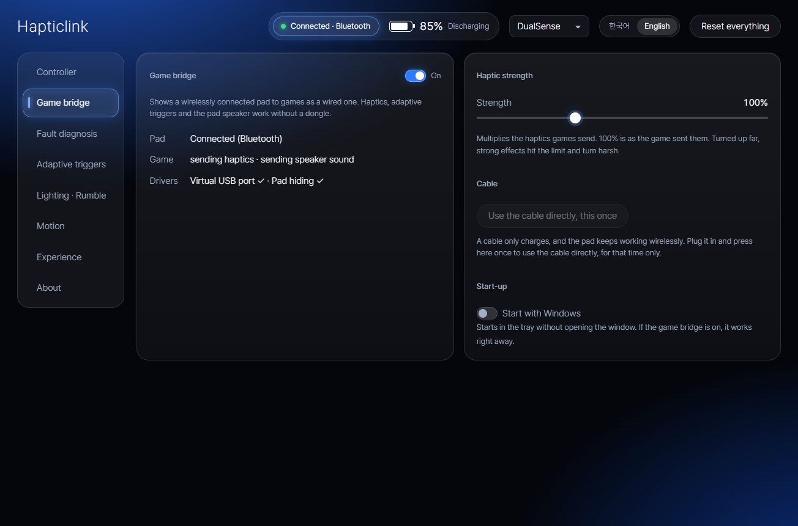
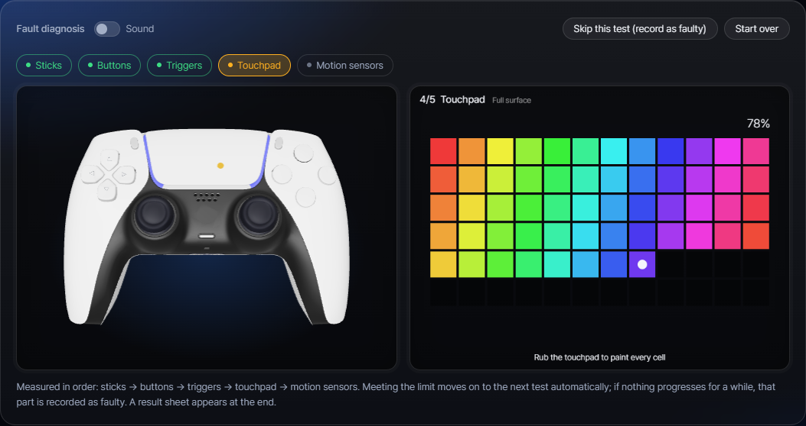
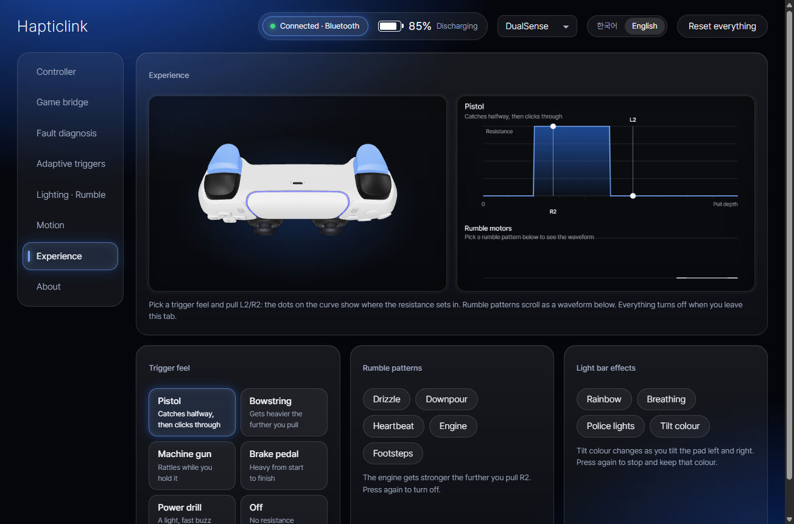
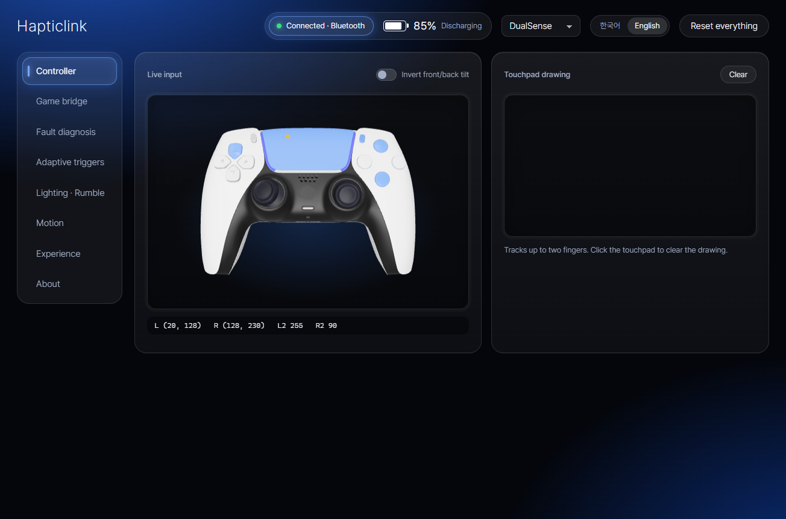

  

  

  Windows 10/11, 64-bit · 161 MB · not code-signed yet: on the "Windows protected your PC" screen choose <i>More info</i>, then <i>Run anyway</i> · <a href="https://github.com/Johyeonwoooooooo/Hapticlink/releases">all releases</a>

  Found a bug, or have a question? Please open an issue or send an email.

  &nbsp;&nbsp;&nbsp;&nbsp;
  

  
  

<h1 align="center">Hapticlink</h1>

  
  
  

---

Hapticlink is a Windows program for the DualSense controller. It does two things for you.

**It lets a wireless pad work in games just like a wired one.** Pair your pad over Bluetooth, open Hapticlink, and start your game. Haptic feedback, adaptive triggers and the controller speaker all work, with no cable and no dongle.

**It tells you whether a pad is healthy.** It is handy when you suspect stick drift, or after a repair. Simply follow what the screen asks, and it will tell you, part by part, whether each one is fine or faulty.

Everything stays on your PC. Hapticlink sends nothing about you or your computer anywhere. It connects outside only when you ask it to update.

## 0.7 ms ahead of the cable, on average

One pad was connected by cable and through Hapticlink at the same time, and the moment each button input reached the PC was compared on both. These are the results over 248 button inputs. The dongle was measured the same way, over 275 button inputs.

| | What you need | Wire | Setup | Button press arrives (average) | Inputs that beat the cable |
| --- | --- | --- | --- | --- | --- |
| **Hapticlink** | **Nothing** | **No** | **Run the installer** | **about 1.27 ms** | **63%** |
| Cable | A USB cable | Yes | Plug it in | about 2.00 ms | - |
| Extra hardware (Pico 2 W dongle) | A Pico 2 W board | No | Buy the board, flash firmware | about 2.28 ms | 27% |

- The arrival times are worked out, not timed directly. A wired pad sends an input every 4 ms, so a press waits 2.00 ms on average; Hapticlink's figure is that minus the measured difference of 0.73 ms, and the dongle's is that plus its measured difference of 0.28 ms. Time spent inside the pad is the same either way and is left out.
- By the median it arrived 0.70 ms sooner, and 88% of inputs were within 4 ms of the cable.
- Hapticlink's processing delay is 1.43 ms (median), and at most 4.01 ms 95% of the time. One frame of a 60 fps game is 16.7 ms.
- The slowest 5% arrived 3.75 ms later or more, and the latest input arrived 11.53 ms later.

A wired DualSense reports every 4 ms, and over Bluetooth it reports every 1.25 ms. So even after the radio and Hapticlink, the wireless input arrives first on average. Wireless does stumble now and then, though: 5 inputs in 100 arrived 3.75 ms or more after the cable.

The processing delay is the time Hapticlink takes to receive an input and pass it on to the game. It was measured three times, against reading the same pad over Bluetooth directly.

The figures against the cable are one 60-second run each, for Hapticlink (v1.0.1) and for the dongle, on one PC. Your Bluetooth adapter and the radio environment around you can change the figures.

## Wireless, with everything a cable gives you

Over Bluetooth, Windows games see a DualSense as a plain gamepad, so there are no haptics, no trigger effects and no speaker. Games send those only to a pad connected by cable.

Hapticlink shows the game a wired DualSense and carries everything across to your real pad over Bluetooth. There is nothing you need to set up in the game.

- **Haptic strength**: you can adjust it from 0 to 300%, and it takes effect while you play.
- **A cable only charges**: you can plug one in mid-game and nothing changes. If you would like the cable's own quality for a session, one button switches to it, and unplugging the cable brings you back to wireless.
- **It stays out of your way**: it sits quietly in the tray, can start with Windows if you wish, and puts everything back the way it was when you quit.

## A one-minute diagnosis

There are five stages, one after another, and just one rule: **follow the amber and you pass.**

Once a stage's limit is met, the next one starts by itself. If nothing progresses for a while, that part is recorded as faulty and the run moves on. You do not need to click anything.

| Stage | What you do | What counts as a fault |
| --- | --- | --- |
| Sticks | Follow the amber dot once around, then let go | A direction that never reaches the rim; resting more than 8% off centre |
| Buttons | Press each of the 19 buttons as it flashes on the 3D pad | No input within 5 seconds |
| Triggers | Match your trigger to the amber one | Cannot hold a middle band; never reads 0 or 255 |
| Touchpad | Paint all 72 cells | A cell that never fills |
| Motion sensors | Line the pad up with the amber pose, then twist it | Tilt not read; a gyro axis that never responds; turning more than 3°/s while still |

The sticks draw their own range as you move them. Wherever the shape is dented, the stick does not reach.

## Results, part by part

At the end you are left with five cards. A healthy part shows its numbers, and a faulty one tells you what failed, for example "No input: L3" or "R stick does not reach ↗". You are welcome to paste it straight into a listing or a repair request.

## See your triggers and rumble

Adaptive triggers are hard to put into words, so Hapticlink draws them for you.

Pick a trigger feel and a curve shows where the resistance sets in; pull the trigger and a dot rides along it. The pistol has a step halfway, the bowstring gets heavier toward the end, and the machine gun rattles. Rumble patterns scroll past as a waveform for each motor.

When the pad is paired over Bluetooth, the patterns play as HD haptics on the pad's actuators instead of the rumble motors.

You need neither a PS5 nor a supported game.

## A 3D pad that moves as you press

Buttons light up, sticks tilt and triggers pull. Stand the pad up and the model tips over to show L1, L2, R1 and R2. You can draw on the touchpad, too.

## Everything else

| Tab | What it does |
| --- | --- |
| Adaptive triggers | Choose off, resistance, trigger pull or vibration for L2 and R2 separately. Sliders apply as you move them |
| Lighting · Rumble | Light bar colour, player LEDs, microphone LED, both motors |
| Motion | A 3D model that follows the pad's tilt |

Battery level and charging state are always shown at the top. You can switch the interface between Korean and English.

## Install

Please download the installer from the button at the top, or from [Releases](https://github.com/Johyeonwoooooooo/Hapticlink/releases), and run it.

- Along with Hapticlink, it installs the two drivers the game bridge needs: [usbip-win2](https://github.com/vadimgrn/usbip-win2) 0.9.8.1 and [HidHide](https://github.com/nefarius/HidHide) 1.5.230. Each comes with its maker's own signed installer, and nothing is downloaded during installation.
- Windows may ask you to restart.
- The first time it runs, Hapticlink asks which language to use and whether it should start with Windows. You can change both later.
- The build is not code-signed yet. If you see the "Windows protected your PC" screen, please choose *More info*, then *Run anyway*.
- New versions come through *Update* on the About tab. It needs an internet connection and keeps your settings. You can go back to an older version there too.
- Uninstalling also removes the drivers this installer put in. Drivers that were already on your PC are left untouched.

## Frequently asked questions

**Which games work?**
Games that support the DualSense's haptics and adaptive triggers on PC over a cable should work. If your game uses Steam Input for the pad, please try it both on and off, as different games prefer different settings.

**Is wireless as strong as a cable?**
Not quite. Bluetooth carries a little less detail than a cable, so the same effect feels slightly softer. The strength slider makes up for most of the difference.

**I plugged the cable in and nothing changed.**
That is how it is meant to work: the cable only charges, and play carries on wirelessly. If you would like to use the cable itself, please press "Use the cable directly, this once" in the Game bridge tab and restart your game.

**The pad switched off when I pulled the cable out.**
This can happen after using the cable directly. Just press the PS button and the pad will reconnect wirelessly.

**Do trigger settings made in the panel carry over to games?**
No, they do not. They apply only while that tab is open, and a running game's own settings take priority.

**Does it send anything to a server?**
No, it does not. There are no accounts, no telemetry and no automatic update checks. It connects outside only when you press Update on the About tab, to get the list of versions and the installer from GitHub. The part that draws the screen is built so that it cannot even look up a host name.

## Contact

  &nbsp;&nbsp;&nbsp;&nbsp;
  

If something does not work, or a game does not respond the way you expected, please let us know by opening an [issue](https://github.com/Johyeonwoooooooo/Hapticlink/issues). It helps a great deal if you include:

- your Hapticlink version (shown in the About tab) and your Windows version;
- how the pad is connected (Bluetooth, or by cable);
- the game, and whether Steam Input is on or off for it;
- what you did, what you expected, and what happened instead.

Before opening a new issue, please have a quick look at the [existing ones](https://github.com/Johyeonwoooooooo/Hapticlink/issues) in case yours is already there. For anything you would rather not post in public, you are welcome to write by email.

## Licence

Hapticlink is free for you to use. It is not open source, however; please see [LICENSE](LICENSE) for the details.

## Credits

- 3D model: [PS5 Controller](https://sketchfab.com/3d-models/ps5-controller-b7bb9c5102a04cb0b1966c6d02bad7d6) by Taohid Animation, [CC BY 4.0](https://creativecommons.org/licenses/by/4.0/).
  Parts were separated and named by [Kollynce/dualsense-controller](https://github.com/Kollynce/dualsense-controller);
  pivots, materials and button glyphs were corrected by [MoniYeyu/dualsense-reactive-preview](https://github.com/MoniYeyu/dualsense-reactive-preview), whose version is used with the PlayStation logo and the button symbols (△○×□) removed.
- [three.js](https://github.com/mrdoob/three.js): MIT.
- Font: [Pretendard](https://github.com/orioncactus/pretendard), SIL Open Font License 1.1.

This is an unofficial project and is not affiliated with Sony Interactive Entertainment. PlayStation, DualSense and PS5 are trademarks or registered trademarks of Sony Interactive Entertainment Inc.
